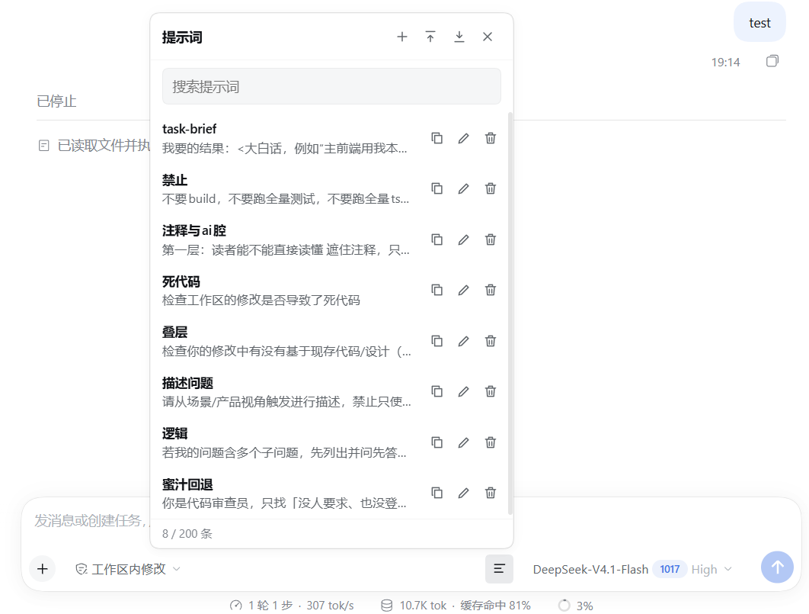
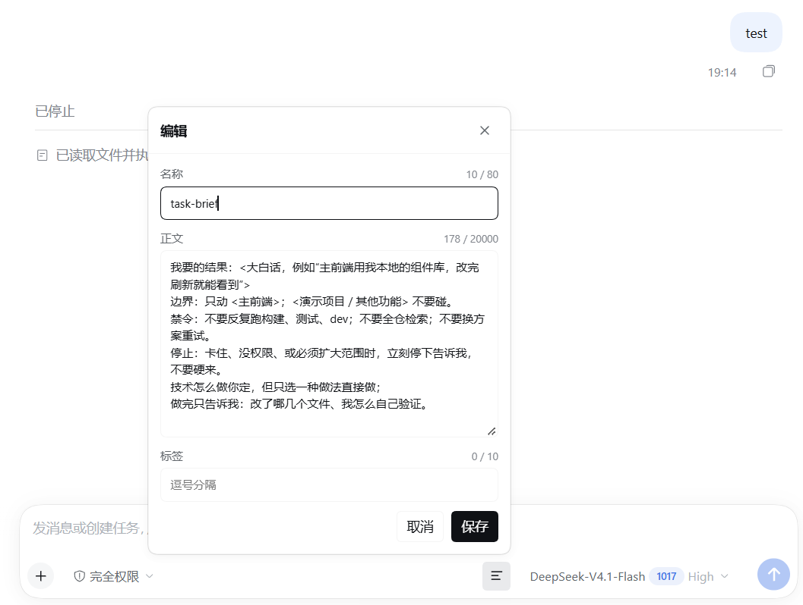

# dsh-prompt-palette

dsh-prompt-palette 是一个 DSH Web 插件，用面板管理常用提示词。面板支持搜索和编辑；编辑草稿时点一条，即可追加到当前草稿末尾。

面板从 composer 右侧的按钮打开，以浮层形式显示。条目保存在浏览器的 `localStorage` 中，不离开本机。

## 预览

点输入框右侧的提示词按钮打开面板，条目支持搜索、复制、编辑和删除：



编辑条目时填写名称、正文和标签，正文即插入草稿的内容：



## 安装

插件的前端入口 `dist/client.js` 是构建产物，仓库里放的是源码，因此需要先 clone 并构建一次：

```bash
git clone https://github.com/shikakokou/dsh-prompt-palette.git
cd dsh-prompt-palette
pnpm install
pnpm build
```

然后在克隆目录中把它装进 profile：

```bash
dsh plugin --profile web add .
```

安装后重启对应的 `dsh` profile。profile 中保存的是插件副本（依赖由 pnpm 注入），所以换了目录或重新构建之后，要重新执行一次 `remove` 和 `add`。

## 使用

- 输入框右侧会出现提示词按钮，点击后打开面板。
- 点条目：把条目追加到当前草稿，草稿非空时另起一行。插入后面板自动关闭。
- 已插入：标记显示在条目名称后面，判定依据是输入框中的文本，比较时忽略换行和缩进。删改草稿后重新打开面板，标记随之更新。
- 点面板外的区域或按 Esc 关闭面板；点提示词按钮本身也可以开关面板。
- 复制：把条目正文写入剪贴板。
- 导入／导出：格式为 JSON。导入时按 `id` 覆盖已有条目，没有对应条目则新建，可用于换机器或备份。
- 搜索匹配名称、正文和标签；标签也可以用于筛选。
- 界面文案跟随 DSH 的语言设置（中文／English）。
- 首次运行会写入一条 `task-brief` 模板；删除后需要通过导入恢复。
- 上限：200 条，名称 80 字，正文 20000 字，标签 10 个。超过上限时拒绝保存并给出提示。

## 数据

数据保存在浏览器的 `localStorage` 中，键为 `dsh.prompt-palette.v1`，同一源下的 profile 共用。清除站点数据时这些内容会一并删除，重要内容建议先导出。

## 开发

```bash
pnpm install
pnpm typecheck   # tsc --noEmit
pnpm test        # vitest run
pnpm build       # 产出 dist/client.js
```

### 结构

| 文件 | 作用 |
|---|---|
| `index.js` | 宿主入口（空实现，仅用于让 profile 识别为 bundle） |
| `cordis.patch.yml` | 向 profile 注册插件 |
| `src/client.tsx` | 按钮、面板、编辑与增删改查 |
| `src/placement.ts` | 浮窗定位，避免超出视口 |
| `src/model.ts` | 上限、追加、匹配、已插入判定、导入合并 |
| `src/storage.ts` | `localStorage` 读写与校验 |
| `src/locales/{zh,en}.json` | 文案 |
| `vite.config.ts` | 打包为 CJS，并在外层包一层 DSH 的 `__ModuleLoader__` 外壳 |

`pnpm build` 产出的 `dist/client.js` 已经包含 `__ModuleLoader__` 外壳。`dist/` 是构建产物，已列入 `.gitignore`。`index.js` 是宿主入口，不需要构建。

### 改完怎么生效

profile 中安装的是插件副本，workspace 里的 `dist` 更新后需要重新 `add` 一次。以下命令都在克隆目录中执行：

```bash
pnpm build
dsh plugin --profile web remove dsh-prompt-palette
dsh plugin --profile web add .
```

重新安装后立即生效，已打开的页面会自动加载新 bundle（`client-hmr` 每 500ms 轮询一次已安装 bundle 的文件状态）。

## 卸载

```bash
dsh plugin --profile web remove dsh-prompt-palette
```
